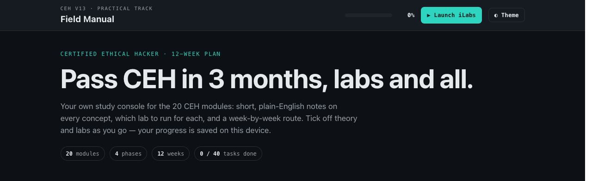
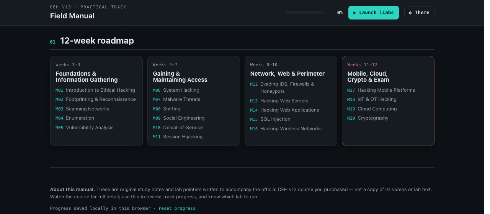
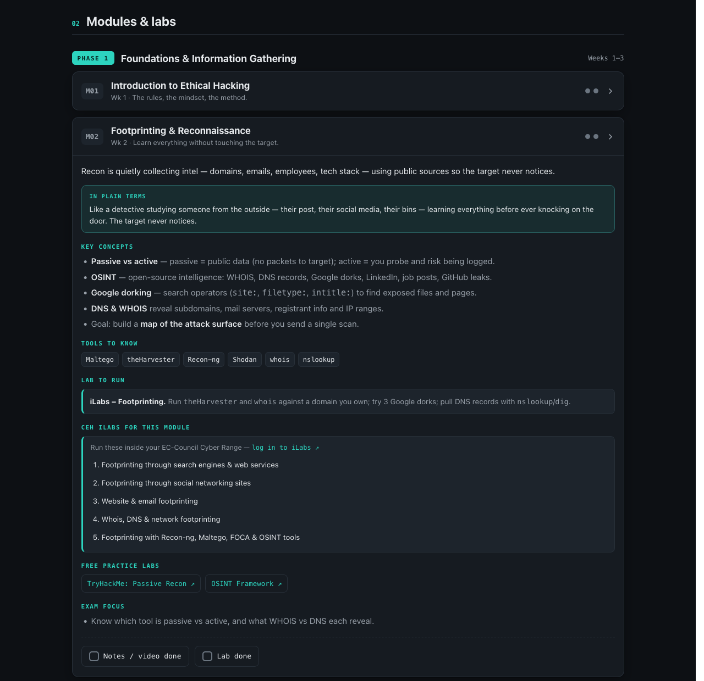

<div align="center">



# 🛡️ CEH Field Manual

**Your own study console for the Certified Ethical Hacker (CEH v13) exam — a 12-week plan, plain-English notes on all 20 modules, the exact labs to run, cheat-sheets, and a practice quiz. One page, no login, works offline.**

[](https://samiullahsaleem.github.io/ceh-field-manual/)


### 🔗 **[samiullahsaleem.github.io/ceh-field-manual](https://samiullahsaleem.github.io/ceh-field-manual/)**

</div>

---

## ✨ What's inside

| | |
|---|---|
| 🗺️ **12-week roadmap** | The whole CEH path split into 4 phases, week by week, so you always know what's next. |
| 📘 **Plain-English notes** | Every one of the 20 modules explained in simple words, with an "in plain terms" analogy that makes each concept click. |
| 🧪 **The labs to run** | Each module lists its **official CEH v13 iLabs exercises** by name (log in and run them) **plus free practice labs** (TryHackMe, PortSwigger, HackTheBox…). |
| ⌨️ **Command cheat-sheets** | The Nmap, enumeration, cracking and web commands you'll actually type — ready to copy. |
| 🔌 **Port & protocol reference** | The ports and services the exam loves to ask about, in one table. |
| ❓ **Practice quiz** | 15 original, scenario-style questions with explained answers. |
| ✅ **Progress tracking** | Tick off notes and labs per module; your progress bar is saved on your device. |
| 🌗 **Light & dark, any device** | Responsive layout, theme toggle, and it keeps working with no internet. |

## 📸 A look inside

**The 12-week roadmap — all 20 modules across 4 phases**



**Every module: plain-terms notes, tools, the iLabs to run, and free practice labs**



## 🚀 How to use it

**Online (easiest):** just open **[the live site](https://samiullahsaleem.github.io/ceh-field-manual/)** on any phone or laptop. Your ticks and progress save in that browser.

**Offline / local:**

```sh
git clone https://github.com/samiullahsaleem/ceh-field-manual.git
cd ceh-field-manual
open index.html          # macOS — or just double-click the file
```

It's a single self-contained `index.html`: no build step, no server, no dependencies.

**The weekly rhythm it's built around:**

1. **Watch** the module video in your EC-Council course for the full detail.
2. **Read** the notes here to lock the concept in simple words.
3. **Run the lab** — the module's iLabs exercise, or a free practice lab.
4. **Tick it off** and review weekly. Repetition is what passes CEH.

## 🧪 About the labs

Each module shows two kinds of labs:

- **CEH iLabs for this module** — the official exercise names from the public CEH v13 course outline, with a link to log in at `learn.eccouncil.org` and run them in the EC-Council Cyber Range. These are **references only** (titles you find your labs by), not course content.
- **Free practice labs** — open alternatives you can do without using up iLab time.

> **Only attack machines you own or are given (iLabs, TryHackMe, HackTheBox, etc.). Scanning or attacking anything else is illegal.**

## 📝 About this manual

These are **original study notes and lab pointers**, written in plain language to accompany the official CEH v13 course — **not a copy** of its videos, slides or lab text. Use them to review alongside the course you purchased, to track your progress, and to know which lab to run next.

## 📄 License

Personal study material — free to use, fork and adapt for your own CEH prep.

<div align="center">
<sub>Built as a single self-contained HTML page · <a href="https://samiullahsaleem.github.io/ceh-field-manual/">open the live site →</a></sub>
</div>
